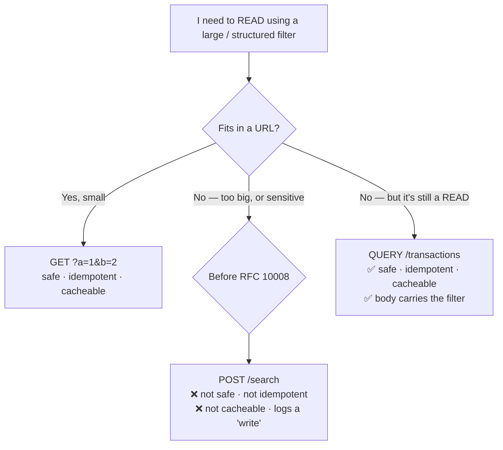

# The HTTP QUERY Method — The First Genuinely New HTTP Verb in Sixteen Years

> HTTP almost never learns a new word. For nearly thirty years, `GET` has been the only honest way to *ask* the web a question — and it can't carry a body — so we lied, sending `POST` for searches and pretending they weren't mutations. In June 2026, **RFC 10008** ended that with `QUERY`: a request that carries a body yet stays *safe, idempotent, and cacheable*. Here's why it matters, and how it fits alongside the methods you already know.

Here's the part that makes `QUERY` a story and not a footnote: **the HTTP method set barely moves in a career.** The vocabulary was frozen a generation ago.

| Year | HTTP version / RFC | Methods introduced |
|------|--------------------|--------------------|
| 1991 | HTTP/0.9 | `GET` |
| 1996 | HTTP/1.0 — RFC 1945 | `HEAD`, `POST` |
| 1997 | HTTP/1.1 — RFC 2068 | `PUT`, `DELETE`, `OPTIONS`, `TRACE`, `CONNECT` |
| 2010 | RFC 5789 | `PATCH` |
| **2026** | **RFC 10008** | **`QUERY`** |

After HTTP/1.1 in 1997, the core set essentially stopped changing. The *only* broadly adopted general-purpose method added in the twenty-nine years since was **`PATCH` (2010)**. (WebDAV bolted on `PROPFIND`, `MKCOL`, `COPY` and friends in between, but those are a niche extension — not verbs a typical REST API ever touches.) So however you count it, `QUERY` is a landmark:

- the **first new general-purpose HTTP method in ~16 years**, since `PATCH`; and
- the first new **safe** method — a new way to *read* — since HTTP/1.1 in **1997**.

**So why now?** Because the workaround finally got too expensive. The web became read-heavy and API-first: faceted search, GraphQL-style queries, analytics filters, policy and feature-flag lookups, and now semantic/vector search all send *large, structured read payloads*. Teams reached for the only verb that carries a body — `POST` — and paid for the lie: `POST` tells every cache, proxy, and retry layer *"this changes state — don't cache me, don't repeat me,"* so a read-only search loses edge caching, loses safe retries, and buries its filter — often full of account numbers and other sensitive fields — in a request the whole stack treats as a mutation. Two things finally made the fix practical: caches and CDNs matured to key on request bodies, and HTTP's semantics were cleanly re-specified in **RFC 9110 (2022)**, separating a method's *properties* (safe / idempotent / cacheable) from the method itself — leaving a neatly labelled slot for a safe, idempotent, cacheable verb that carries a body.

Before we get to `QUERY` itself, a quick, honest tour of the methods it joins.

---

## The standard HTTP methods, by their real properties

There are nine registered methods most teams touch. What matters for testing isn't the verb's name — it's three properties that govern how the whole network treats it:

- **Safe** — the request is not *intended* to change server state. Safe requests can be pre-fetched, retried freely, and are assumed side-effect-free.
- **Idempotent** — making the request N times has the same effect as making it once. This is what lets a client (or a proxy, or a mobile network) retry after a timeout without fear.
- **Cacheable** — a response may be stored and reused for later equivalent requests.

| Method   | Safe | Idempotent | Cacheable | Request body | What it's for |
|----------|:----:|:----------:|:---------:|:------------:|---------------|
| `GET`    | ✅   | ✅         | ✅        | ✗ (ignored)  | Retrieve a representation of a resource |
| `HEAD`   | ✅   | ✅         | ✅        | ✗            | Like `GET`, headers only — existence, size, `ETag` checks |
| `POST`   | ✗    | ✗          | rarely    | ✅           | Process the payload; create, submit, "do a thing" |
| `PUT`    | ✗    | ✅         | ✗         | ✅           | Replace the target resource with the payload |
| `PATCH`  | ✗    | ✗          | ✗         | ✅           | Apply a partial modification |
| `DELETE` | ✗    | ✅         | ✗         | optional     | Remove the target resource |
| `OPTIONS`| ✅   | ✅         | ✗         | optional     | Ask what's allowed (CORS pre-flight lives here) |
| `TRACE`  | ✅   | ✅         | ✗         | ✗            | Loop-back diagnostic; usually disabled for security |
| `CONNECT`| ✗    | ✗          | ✗         | —            | Establish a tunnel (HTTPS through a proxy) |

A few things worth internalising as a tester:

- **`PATCH` is not idempotent** by default. `PUT` replaces (send it twice, same result); `PATCH` applies a delta (`{"balance": "+100"}` applied twice is a real bug). Test them differently.
- **`DELETE` is idempotent, not safe.** Deleting an already-deleted resource should still land you in a "gone" state — a second `DELETE` returning `404` instead of `204` is a classic idempotency smell.
- **`OPTIONS` is where CORS pre-flight happens.** If a browser client "randomly" fails, check whether the pre-flight `OPTIONS` was answered correctly before blaming the real call.
- **`TRACE` should usually be off.** If it's enabled, that's a finding, not a feature (Cross-Site Tracing).

---

## The same methods, on one resource

Properties are abstract until you watch them on a real endpoint. Here's a `/users` collection walked through the verbs you'll actually test — pay attention to what happens on the **second** identical call:

```http
# READ — safe, cacheable, no body. Ask as often as you like; nothing changes.
GET    /users/42        →  200  { "id": 42, "name": "Ada", "tier": "gold" }

# CREATE — NOT idempotent. Send it twice, get two users.
POST   /users           { "name": "Ada" }   →  201  Location: /users/42
POST   /users           { "name": "Ada" }   →  201  Location: /users/43   ⚠ duplicate

# REPLACE — idempotent. The resource becomes exactly this body, every time.
PUT    /users/42        { "name": "Ada", "tier": "silver" }  →  200
PUT    /users/42        { "name": "Ada", "tier": "silver" }  →  200   ✓ same end state

# PARTIAL UPDATE — the verb can be idempotent, but the PAYLOAD decides.
PATCH  /users/42        { "tier": "platinum" }   →  200   ✓ absolute value, safe to repeat
PATCH  /users/42        { "loginCount": "+1" }   →  200   ⚠ relative op, NOT idempotent

# DELETE — idempotent. Gone stays gone.
DELETE /users/42        →  204
DELETE /users/42        →  404 (or 204) — either way, 42 is still gone
```

The three write verbs are where teams get burned, and nearly every one of those bugs is an **idempotency** bug:

- **`POST` is not idempotent — treat every retry as dangerous.** A timeout on `POST /payments` doesn't tell you whether the charge landed. Retry blindly and you double-charge. The fix isn't "never retry," it's an **idempotency key**: the client sends a unique key, the server records it, and a repeat with the same key returns the *original* result instead of acting again. Test that a retried `POST` with the same key creates **one** record, not two.
- **`PUT` replaces, and must be idempotent — so prove it is.** `PUT /users/42` should leave the resource in *exactly* the body you sent, whether you send it once or five times. A `PUT` that appends, increments, or silently preserves fields you omitted is a broken `PUT`. The classic bug: omitting `tier` and finding the old value still there.
- **`PATCH` is only as idempotent as its payload.** A patch of absolute values (`{"tier":"platinum"}`) is safe to replay. A patch of *relative* operations (`{"balance":"+100"}`, or JSON Patch `add`/`remove`) is not — replay it and the balance keeps climbing. This is the single most-missed distinction in API tests.

The rule of thumb to encode: **`GET` `HEAD` `PUT` `DELETE` are safe to retry; `POST` and `PATCH` are not — assume nothing.** When a proxy, mobile network, or retry layer repeats a request on your behalf, that line is the difference between a resilient system and a double-charged customer.

Notice the top of the methods table: only `GET` and `HEAD` are safe, idempotent *and* cacheable — and neither can carry a body. That is the exact, decades-old gap `QUERY` closes.

---

## Enter QUERY (RFC 10008, June 2026)

`QUERY` is best understood in one line: **it is `GET` with a request body, done honestly.** The spec grants it the properties reads have always wanted together:

- **Safe** — a server MUST NOT treat a `QUERY` as a request to change the target resource's state.
- **Idempotent** — it can be retried or repeated without additional effect.
- **Cacheable** — a cache MAY store the response and use it to satisfy later equivalent `QUERY` requests.
- **Carries a body** — the query itself travels in the request content, with a `Content-Type`. Servers MUST reject the request if `Content-Type` is missing (`400`) or unsupported (`415`).



A request looks exactly like the `POST` you'd write today — but the verb now tells the truth:

```http
QUERY /v1/transactions HTTP/1.1
Host: api.example-bank.com
Content-Type: application/json
Accept: application/json

{
  "accountIds": ["acc_1029", "acc_3841", "acc_7720"],
  "dateRange": { "from": "2026-01-01", "to": "2026-06-30" },
  "amount": { "min": 500.00, "currency": "GBP" },
  "categories": ["card_payment", "direct_debit"],
  "risk": { "flagged": true }
}
```

Two response details are new and worth testing for:

- **`Content-Location`** — a successful response MAY include a `Content-Location` header pointing at a URL that represents *these results*. Clients (and caches) can then `GET` that URL later without resending the body. It turns an expensive query into a shareable, cacheable resource.
- **`Accept-Query`** — a server can advertise which query formats it understands via the `Accept-Query` response field, so clients can negotiate (`application/json`, `application/sql`, a custom filter grammar, etc.).

And the one that will bite you if you skim the RFC: **the cache key MUST incorporate the request body and its metadata.** For `GET`, the cache key is essentially the URL. For `QUERY`, two requests to the same URL with *different bodies* are different queries — the cache has to key on the body too, or it will serve one customer's results to another.

---

## Why fintech should care more than most

This isn't just tidier semantics. For a regulated, high-volume financial API, `QUERY` touches three things auditors and SREs care about.

**1. Sensitive data leaves the URL.** Account numbers, card BINs, customer identifiers, date-of-birth filters — anything you put in a `GET` query string is logged everywhere: load-balancer access logs, CDN logs, APM traces, the browser's history, and the `Referer` header sent to third parties. Moving the filter into a `QUERY` body keeps PII and PAN-adjacent data out of URLs by default. That's a direct, demonstrable control for **PCI-DSS** and **GDPR** data-minimisation reviews.

**2. Honest idempotency means safe retries.** Reconciliation jobs, statement generation, and reporting pipelines re-run constantly and retry on flaky networks. When a search is a `POST`, every retry layer has to *assume* it might be a write and either refuse to retry or build bespoke idempotency-key plumbing. `QUERY` is idempotent by contract — the mobile client, the service mesh, and the batch runner can all retry a timed-out search safely.

**3. Expensive reads become cacheable again.** "Show me this account's last 90 days, filtered six ways" is costly to compute and often repeated verbatim (pagination, refreshes, dashboards). Under `POST` you can't cache it at the edge without lying to your caches. `QUERY` lets a CDN or reverse proxy cache the response keyed on the body — provided that keying is correct, which is exactly the thing your tests must prove.

---

## What it changes for API testing

Not much mechanically — and that's the point. `QUERY` is just a method string, so `fetch`, `curl`, Playwright's `request`, and k6 all send it today by setting the method:

```js
await request.fetch(url, {
  method: "QUERY",
  headers: { "Content-Type": "application/json" },
  data: filter,
});
```

Only two assertions are genuinely new, and both are cheap:

- **Safety + idempotency** — fire the same `QUERY` twice; assert server state is unchanged and both responses match. A `QUERY` that mutates is a bug *and* a security issue.
- **The cache keys on the body** — send two *different* bodies to the same URL and assert they don't return each other's cached results. Get this wrong in fintech and the edge serves account A's data in response to account B's query. It's the one test I'd never skip.

Everything else is negative-path coverage you already write: missing/unsupported `Content-Type` → `400`/`415`, and — during the transition — old proxies and gateways answering `405`/`501`, which your client should feature-detect and fall back from to `POST`.

---

## Lessons learned

- **The verb is a contract with the whole network, not just the server.** `GET`, `POST`, `PUT`, `PATCH`, `DELETE` each promise something to every cache and retry layer in the path. Most production bugs on the write verbs are really *idempotency* bugs — `POST` retried into a duplicate, a `PATCH` of relative values replayed one time too many.
- **A new HTTP method is a rare event — take it seriously.** `QUERY` is the first new general-purpose verb since `PATCH` in 2010, and the first new *safe* one since 1997. The method set barely moves in a career; when it does, it's because a workaround finally became too costly to keep pretending about.
- **`QUERY` is `GET` with a body, done honestly.** Reach for it when you're *reading* with a filter too large or too sensitive for a URL — and stop paying the caching and idempotency tax that `POST`-for-search always charged.
- **In fintech, the headline win is data staying out of URLs**, with idempotent retries and edge caching close behind. The one test to never skip: two different bodies to the same URL must never share a cached response.

`POST`-for-search was always a workaround we agreed to stop noticing. `QUERY` removes the excuse — the first time in most of our careers that HTTP has learned a new way to ask a question.

---

*Written from real-world experience testing financial APIs at scale. RFC 10008 ("The HTTP QUERY Method") was published by the IETF in June 2026; all endpoints, hosts, and payloads here are generic illustrations.*
